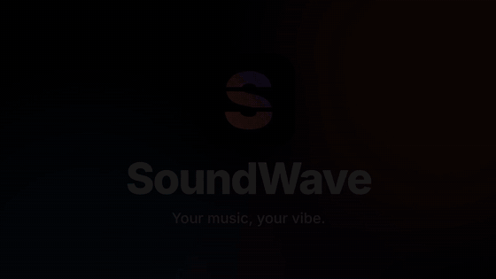

<h1 align="center">SoundWave</h1>
<p align="center"><b>Your music, your vibe.</b> A desktop music player with the music video playing behind your songs, synced lyrics and 20 themes.</p>

<p align="center"></p>

---

## Features

- **YouTube search and playback**: artists, songs, artist pages, best video quality (up to 4K).
- **The music video as your background**, with blur and cinema effects, or a video-only mode.
- **Synced lyrics** in a side panel. Click a line to jump to that moment.
- **Playlists**: liked songs, recently played, your own playlists, and imports from **YouTube** and **Spotify**.
- **Queue** (play next, add to queue, drag to reorder) and **crossfade** between songs.
- **Equalizer**: bass, treble, 10 bands, presets.
- **20 themes** plus your own custom theme.
- **Discord status** ("Listening to SoundWave"), keyboard media keys, sleep timer.
- Stays in the notification area when closed. Only one window at a time.
- In **English, French and Spanish**.

## Download (Windows)

1. Go to [**Releases**](../../releases) and download `SoundWave-Windows.zip`.
2. Unzip it anywhere and run **`SoundWave.exe`**.
3. On first launch, SoundWave asks for a free **YouTube API key**. The app explains how to get one in about 5 minutes.

> Windows may show a SmartScreen warning because the app is not signed: click **More info → Run anyway**.

## Run from source

```bash
npm install
npm start
```

Requires [Node.js](https://nodejs.org). `npm test` runs the unit tests.

## Notes

- Music is played through YouTube's official embedded player. SoundWave does not download anything.
- Spotify import needs your own Spotify app Client ID (explained in the app).
- Your API keys stay on your computer.
